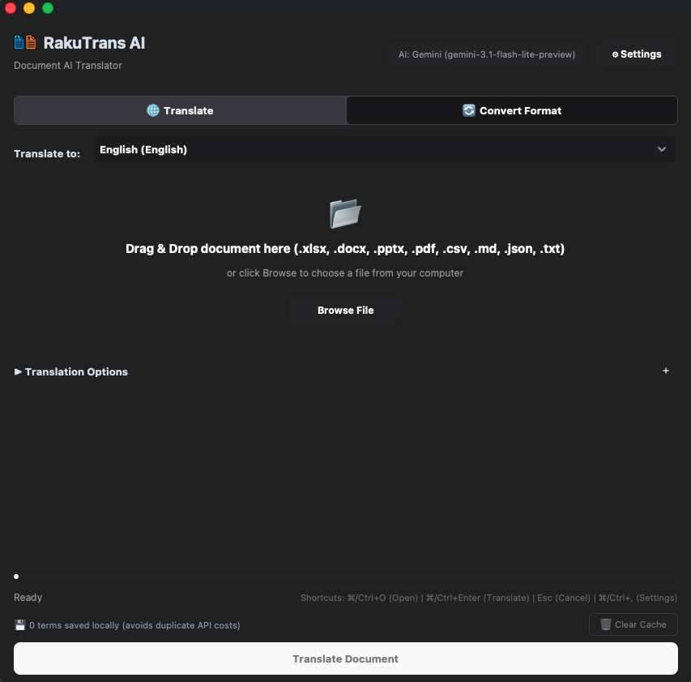

# RakuTrans AI

[English](README.md) | [日本語](README.ja.md) | [Tiếng Việt](README.vi.md)

多彩なファイル形式に対応したAIドキュメント翻訳デスクトップアプリ：**PDF (`.pdf`)**、**Word (`.docx`)**、**Excel (`.xlsx`)**、**PowerPoint (`.pptx`)**、**CSV/TSV (`.csv`, `.tsv`)**、**JSON (`.json`)**、**プレーンテキスト (`.txt`)**、**Markdown (`.md`)**。

<p align="center">
  
</p>

---

## 使用技術

- **開発言語**: Python 3.10+
- **GUIフレームワーク**: CustomTkinter, TkinterDnD2
- **ドキュメント処理**: PyMuPDF & pdf2docx (PDF), python-docx (Word), OpenPyXL (Excel), python-pptx (PowerPoint), MarkItDown (Markdown)
- **AIプロバイダー**: Google GenAI (`google-genai`), OpenAI (`openai`), Anthropic Claude (`anthropic`)
- **ストレージ & キャッシュ**: SQLite3 (翻訳メモリ), JSON (設定 & モデルキャッシュ)
- **パッケージング**: PyInstaller, Inno Setup 6 (Windows)

---

## インストール & クイックスタート

自動環境構築スクリプト（Python 3.10+ 自動検出、`.venv` 修復、依存パッケージ自動インストール）を同梱しています：

### 方法 1: ワンクリック起動（推奨）

- **macOS / Linux**:
  ```bash
  ./run.sh
  ```
- **Windows**: `run_windows.bat` をダブルクリック、またはコマンドプロンプトで実行:
  ```cmd
  run_windows.bat
  ```

*(初回実行時またはディレクトリ移動時も自動的に環境が修復・初期化され、アプリが立ち上がります)。*

### 方法 2: 事前環境セットアップ

事前に環境を構築・確認したい場合：
- **macOS / Linux**: `./setup_env.sh`
- **Windows**: `setup_env.bat`

---

## スタンドアロンアプリのビルド・リリース

Pythonのインストールが不要な実行ファイル・インストーラーを生成します：

- **macOS (`.app` & `.dmg`)**: `./build_macos.sh` → `dist/RakuTrans.app` および `dist/RakuTrans-Installer-macOS.dmg` を出力
- **Windows (`.exe` & インストーラー)**: `build_windows.bat` → `dist\RakuTrans\RakuTrans.exe` および `dist\RakuTrans-Installer-Windows.exe` を出力（Inno Setup 6 導入時、詳細は [WINDOWS_INSTALLER_GUIDE.md](WINDOWS_INSTALLER_GUIDE.md) を参照）

### インストール・アップデート方法（ユーザー向け）

[GitHub Releases](https://github.com/phunglb-pivot/rakutrans/releases) から最新版をダウンロードしてください。**古いバージョンを事前にアンインストールする必要はありません**（APIキー・設定・翻訳キャッシュ `~/.rakutrans/` は引き継がれます）：

- **Windows (`RakuTrans-Installer-Windows.exe`)**: そのまま実行して上書きアップデートできます（起動中のアプリを自動終了し、古いランタイムファイルも整理します）。*(未署名のビルドで SmartScreen 警告が出た場合は **詳細情報 → 実行** をクリックしてください。)*
- **macOS (`RakuTrans-Installer-macOS.dmg`)**: RakuTrans AI を終了 (`⌘Q`) し、`.dmg` を開いて **RakuTrans.app** を **Applications** へドラッグし **「置き換える (Replace)」** を選択します。*(未署名・未公証ビルドで初回起動がブロックされた場合は、**システム設定 → プライバシーとセキュリティ → このまま開く**、または `xattr -cr /Applications/RakuTrans.app` を実行してください。)*
- **アプリ内アップデート確認**: 起動時に GitHub Releases の新バージョンを自動チェックします（**設定 → バージョン・アップデート** から手動確認や自動チェックの切り替えが可能）。

### 新バージョンのリリース手順（開発者向け）

1. `config.py` の `APP_VERSION` を更新（例: `"1.0.1"`）し、`main` にコミットします。
2. 一致するタグを作成してプッシュします：
   ```bash
   git tag v1.0.1 && git push origin main v1.0.1
   ```
3. GitHub Actions（[.github/workflows/release.yml](.github/workflows/release.yml)）が自動テスト実行、`RakuTrans-Installer-macOS.dmg`・`RakuTrans-Installer-Windows.exe` のビルド、`SHA256SUMS.txt` 生成、GitHub Releases への公開を行います。
