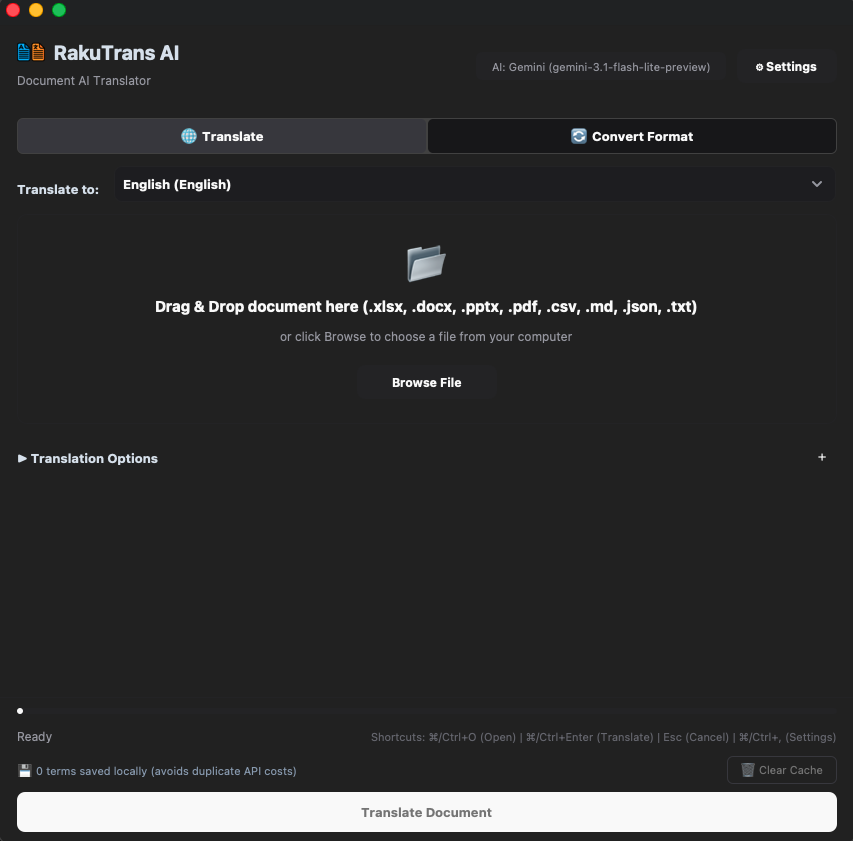

# RakuTrans AI

[English](README.md) | [日本語](README.ja.md) | [Tiếng Việt](README.vi.md)

多彩なファイル形式に対応したAIドキュメント翻訳デスクトップアプリ：**PDF (`.pdf`)**、**Word (`.docx`)**、**Excel (`.xlsx`)**、**PowerPoint (`.pptx`)**、**CSV/TSV (`.csv`, `.tsv`)**、**JSON (`.json`)**、**プレーンテキスト (`.txt`)**、**Markdown (`.md`)**。

<p align="center">
  
</p>

---

## 使用技術

- **開発言語**: Python 3.10+
- **GUIフレームワーク**: CustomTkinter, TkinterDnD2
- **ドキュメント処理**: PyMuPDF & pdf2docx (PDF), python-docx (Word), OpenPyXL (Excel), python-pptx (PowerPoint), MarkItDown (Markdown)
- **AIプロバイダー**: Google GenAI (`google-genai`), OpenAI (`openai`), Anthropic Claude (`anthropic`)
- **ストレージ & キャッシュ**: SQLite3 (翻訳メモリ), JSON (設定 & モデルキャッシュ)
- **パッケージング**: PyInstaller

---

## インストール & クイックスタート

自動環境構築スクリプト（Python 3.10+ 自動検出、`.venv` 修復、依存パッケージ自動インストール）を同梱しています：

### 方法 1: ワンクリック起動（推奨）

- **macOS / Linux**:
  ```bash
  ./run.sh
  ```
- **Windows**: `run_windows.bat` をダブルクリック、またはコマンドプロンプトで実行:
  ```cmd
  run_windows.bat
  ```

*(初回実行時またはディレクトリ移動時も自動的に環境が修復・初期化され、アプリが立ち上がります)。*

### 方法 2: 事前環境セットアップ

事前に環境を構築・確認したい場合：
- **macOS / Linux**: `./setup_env.sh`
- **Windows**: `setup_env.bat`

---

## スタンドアロンアプリのビルド

Pythonのインストールが不要な実行ファイルを生成します：

- **macOS (`.app` & `.dmg`)**: `./build_macos.sh`
- **Windows (`.exe`)**: `build_windows.bat`
