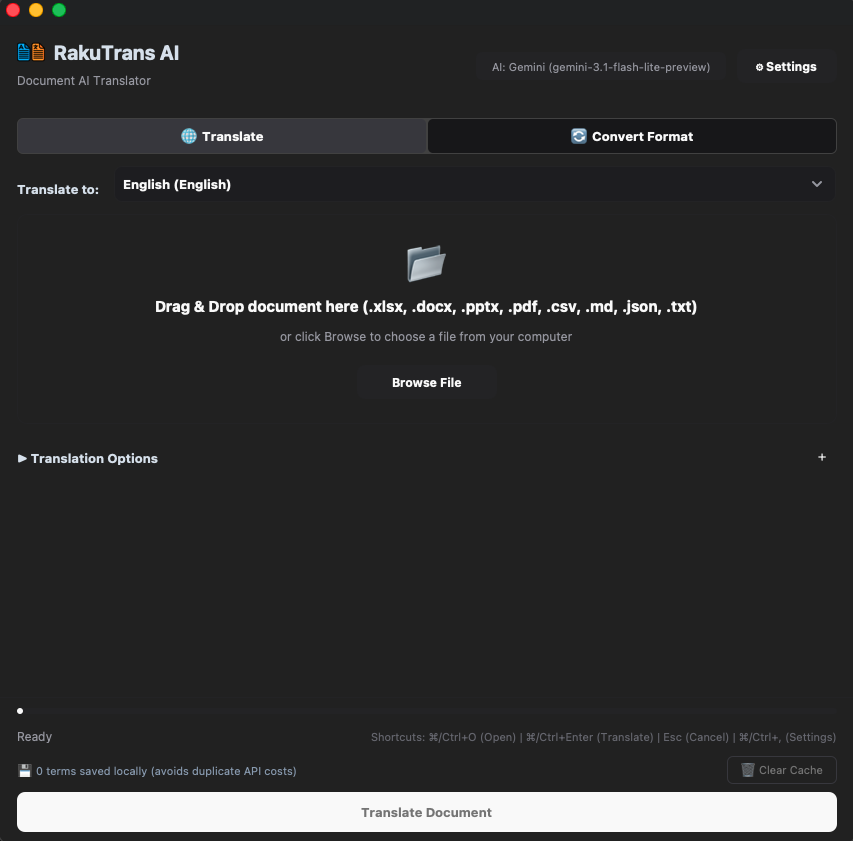

# RakuTrans AI

[English](README.md) | [日本語](README.ja.md) | [Tiếng Việt](README.vi.md)

AI-powered Desktop translation application supporting multiple formats: **PDF (`.pdf`)**, **Word (`.docx`)**, **Excel (`.xlsx`)**, **PowerPoint (`.pptx`)**, **CSV/TSV (`.csv`, `.tsv`)**, **JSON (`.json`)**, **Plain Text (`.txt`)**, and **Markdown (`.md`)**.

<p align="center">
  
</p>

---

## Tech Stack

- **Core Language**: Python 3.10+
- **User Interface (GUI)**: CustomTkinter, TkinterDnD2
- **Document Processing**: PyMuPDF & pdf2docx (PDF), python-docx (Word), OpenPyXL (Excel), python-pptx (PowerPoint), MarkItDown (Markdown)
- **AI Providers**: Google GenAI (`google-genai`), OpenAI (`openai`), Anthropic Claude (`anthropic`)
- **Storage & Cache**: SQLite3 (Translation memory), JSON (Configuration & model cache)
- **Application Packaging**: PyInstaller

---

## Quick Start & Installation

### Installation

```bash
git clone https://github.com/phunglb-pivot/rakutrans.git
cd rakutrans
pip install -r requirements.txt
```

### Run Desktop Application

```bash
./run.sh
# or: python3 main.py
```

---

## Standalone Packaging

Build standalone executables without requiring a Python environment:

- **macOS (`.app` & `.dmg`)**: `./build_macos.sh`
- **Windows (`.exe`)**: `build_windows.bat`
