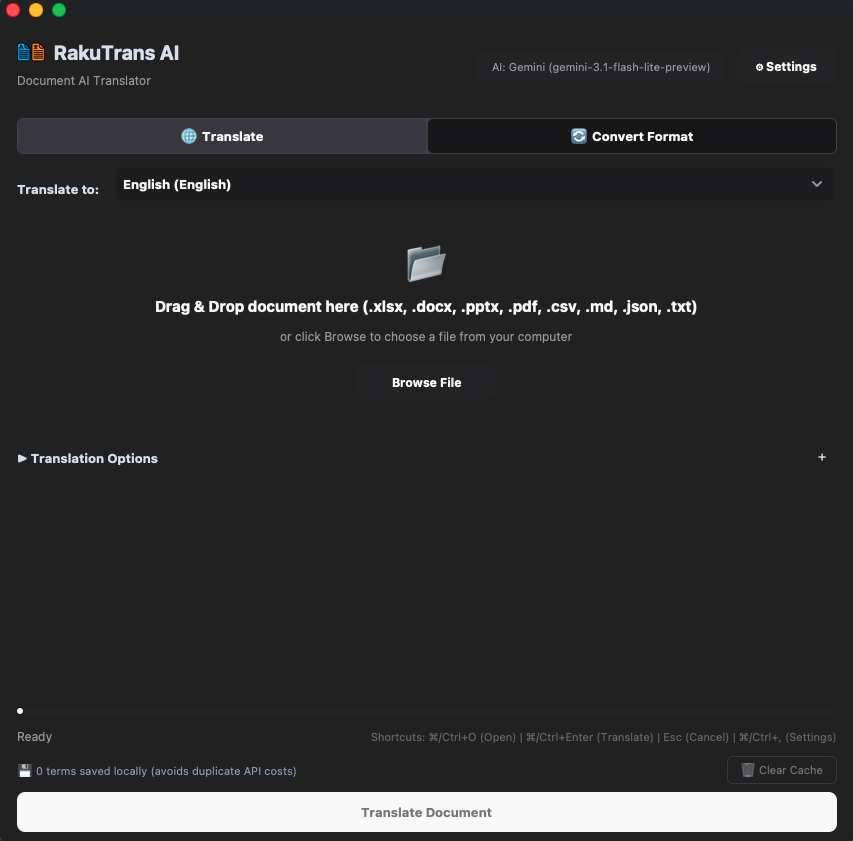

# RakuTrans AI

[English](README.md) | [日本語](README.ja.md) | [Tiếng Việt](README.vi.md)

AI-powered Desktop translation application supporting multiple formats: **PDF (`.pdf`)**, **Word (`.docx`)**, **Excel (`.xlsx`)**, **PowerPoint (`.pptx`)**, **CSV/TSV (`.csv`, `.tsv`)**, **JSON (`.json`)**, **Plain Text (`.txt`)**, and **Markdown (`.md`)**.

<p align="center">
  
</p>

---

## Tech Stack

- **Core Language**: Python 3.10+
- **User Interface (GUI)**: CustomTkinter, TkinterDnD2
- **Document Processing**: PyMuPDF & pdf2docx (PDF), python-docx (Word), OpenPyXL (Excel), python-pptx (PowerPoint), MarkItDown (Markdown)
- **AI Providers**: Google GenAI (`google-genai`), OpenAI (`openai`), Anthropic Claude (`anthropic`)
- **Storage & Cache**: SQLite3 (Translation memory), JSON (Configuration & model cache)
- **Application Packaging**: PyInstaller, Inno Setup 6 (Windows)

---

## Quick Start & Installation

The project includes zero-config self-healing scripts that automatically locate Python 3.10+, create/repair `.venv`, and install dependencies:

### Option 1: One-Click Run (Recommended)

- **macOS / Linux**:
  ```bash
  ./run.sh
  ```
- **Windows**: Double-click `run_windows.bat` or run:
  ```cmd
  run_windows.bat
  ```

*(The scripts automatically set up `.venv`, recover from broken/moved directory paths, and launch the application).*

### Option 2: Standalone Environment Setup

If you prefer to initialize the environment ahead of time:
- **macOS / Linux**: `./setup_env.sh`
- **Windows**: `setup_env.bat`

---

## Standalone Packaging & Releases

Build standalone executables without requiring end-users to have Python installed:

- **macOS (`.app` & `.dmg`)**: `./build_macos.sh` → outputs `dist/RakuTrans.app` and `dist/RakuTrans-Installer-macOS.dmg`
- **Windows (`.exe` & Installer)**: `build_windows.bat` → outputs `dist\RakuTrans\RakuTrans.exe` and `dist\RakuTrans-Installer-Windows.exe` (when Inno Setup 6 is installed; see [WINDOWS_INSTALLER_GUIDE.md](WINDOWS_INSTALLER_GUIDE.md))

### Downloading & Upgrading (End Users)

Download the latest release from [GitHub Releases](https://github.com/phunglb-pivot/rakutrans/releases). **You do not need to uninstall the previous version** — your API keys, settings, and translation cache in `~/.rakutrans/` are preserved across upgrades:

- **Windows (`RakuTrans-Installer-Windows.exe`)**: Run the new installer directly to upgrade over the existing installation (automatically closes a running instance and cleans old runtime files). *(If Windows SmartScreen warns on unsigned builds, click **More info → Run anyway**.)*
- **macOS (`RakuTrans-Installer-macOS.dmg`)**: Quit RakuTrans AI (`⌘Q`), open the `.dmg`, drag **RakuTrans.app** into **Applications**, and choose **Replace**. *(On unsigned/unnotarized builds, if Gatekeeper blocks first launch, allow it via **System Settings → Privacy & Security → Open Anyway** or run `xattr -cr /Applications/RakuTrans.app`.)*
- **In-App Update Check**: RakuTrans AI automatically checks GitHub Releases on startup (configurable under **Settings → Application & Updates**).

### Publishing a New Release (Maintainers)

1. Bump `APP_VERSION` in `config.py` (e.g., `"1.0.1"`) and commit to `main`.
2. Create and push the matching tag:
   ```bash
   git tag v1.0.1 && git push origin main v1.0.1
   ```
3. GitHub Actions ([.github/workflows/release.yml](.github/workflows/release.yml)) automatically runs unit tests, builds `RakuTrans-Installer-macOS.dmg` and `RakuTrans-Installer-Windows.exe`, generates `SHA256SUMS.txt`, and publishes the GitHub Release.
