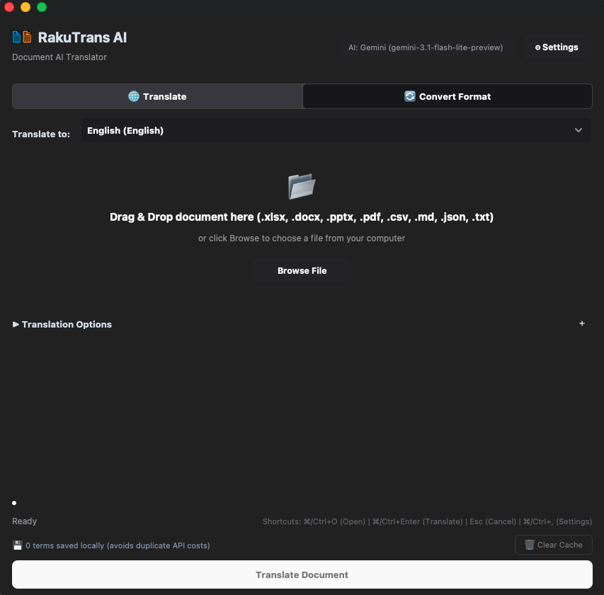

# RakuTrans AI

[English](README.md) | [日本語](README.ja.md) | [Tiếng Việt](README.vi.md)

Ứng dụng Desktop dịch thuật bằng AI hỗ trợ đa định dạng: **PDF (`.pdf`)**, **Word (`.docx`)**, **Excel (`.xlsx`)**, **PowerPoint (`.pptx`)**, **CSV/TSV (`.csv`, `.tsv`)**, **JSON (`.json`)**, **Plain Text (`.txt`)** và **Markdown (`.md`)**.

<p align="center">
  
</p>

---

## Công nghệ sử dụng

- **Ngôn ngữ nền tảng**: Python 3.10+
- **Giao diện (GUI)**: CustomTkinter, TkinterDnD2
- **Xử lý tài liệu**: PyMuPDF & pdf2docx (PDF), python-docx (Word), OpenPyXL (Excel), python-pptx (PowerPoint), MarkItDown (Markdown)
- **Nền tảng AI**: Google GenAI (`google-genai`), OpenAI (`openai`), Anthropic Claude (`anthropic`)
- **Lưu trữ & Cache**: SQLite3 (Bộ nhớ dịch thuật), JSON (Cấu hình & Cache model)
- **Đóng gói ứng dụng**: PyInstaller

---

## Cài đặt & Khởi chạy nhanh

Dự án đã được tích hợp bộ script tự động hóa toàn bộ môi trường (tự phát hiện Python, tự tạo & sửa lỗi `.venv`, tự cài đặt thư viện):

### Cách 1: Khởi chạy 1 chạm (Khuyến nghị)

- **macOS / Linux**:
  ```bash
  ./run.sh
  ```
- **Windows**: Nhấp đúp vào `run_windows.bat` hoặc chạy trong CMD/PowerShell:
  ```cmd
  run_windows.bat
  ```

*(Script sẽ tự động khởi tạo môi trường ảo, khôi phục nếu thư mục bị di chuyển và mở ứng dụng ngay lập tức).*

### Cách 2: Thiết lập môi trường trước

Nếu bạn muốn chuẩn bị trước môi trường hoặc kiểm tra tương thích:
- **macOS / Linux**: `./setup_env.sh`
- **Windows**: `setup_env.bat`

---

## Đóng gói ứng dụng độc lập

Tạo file chạy trực tiếp không cần người dùng cuối phải cài đặt Python:

- **macOS (`.app` & `.dmg`)**: `./build_macos.sh`
- **Windows (`.exe`)**: `build_windows.bat`
