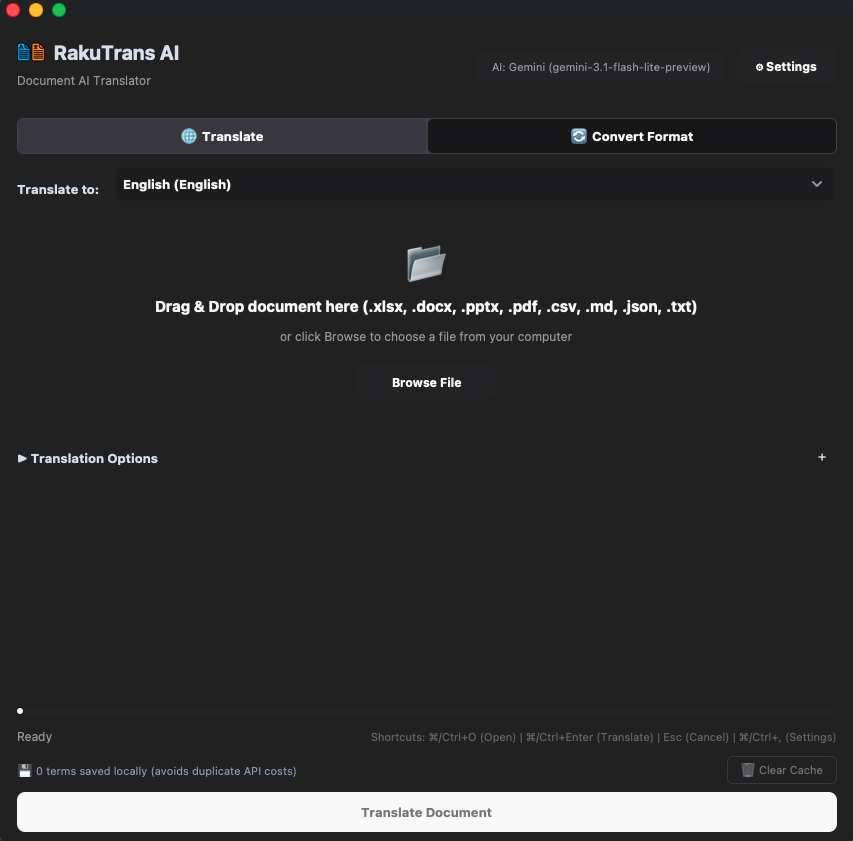

# RakuTrans AI

[English](README.md) | [日本語](README.ja.md) | [Tiếng Việt](README.vi.md)

Ứng dụng Desktop dịch thuật bằng AI hỗ trợ đa định dạng: **PDF (`.pdf`)**, **Word (`.docx`)**, **Excel (`.xlsx`)**, **PowerPoint (`.pptx`)**, **CSV/TSV (`.csv`, `.tsv`)**, **JSON (`.json`)**, **Plain Text (`.txt`)** và **Markdown (`.md`)**.

<p align="center">
  
</p>

---

## Công nghệ sử dụng

- **Ngôn ngữ nền tảng**: Python 3.10+
- **Giao diện (GUI)**: CustomTkinter, TkinterDnD2
- **Xử lý tài liệu**: PyMuPDF & pdf2docx (PDF), python-docx (Word), OpenPyXL (Excel), python-pptx (PowerPoint), MarkItDown (Markdown)
- **Nền tảng AI**: Google GenAI (`google-genai`), OpenAI (`openai`), Anthropic Claude (`anthropic`)
- **Lưu trữ & Cache**: SQLite3 (Bộ nhớ dịch thuật), JSON (Cấu hình & Cache model)
- **Đóng gói ứng dụng**: PyInstaller, Inno Setup 6 (Windows)

---

## Cài đặt & Khởi chạy nhanh

Dự án đã được tích hợp bộ script tự động hóa toàn bộ môi trường (tự phát hiện Python, tự tạo & sửa lỗi `.venv`, tự cài đặt thư viện):

### Cách 1: Khởi chạy 1 chạm (Khuyến nghị)

- **macOS / Linux**:
  ```bash
  ./run.sh
  ```
- **Windows**: Nhấp đúp vào `run_windows.bat` hoặc chạy trong CMD/PowerShell:
  ```cmd
  run_windows.bat
  ```

*(Script sẽ tự động khởi tạo môi trường ảo, khôi phục nếu thư mục bị di chuyển và mở ứng dụng ngay lập tức).*

### Cách 2: Thiết lập môi trường trước

Nếu bạn muốn chuẩn bị trước môi trường hoặc kiểm tra tương thích:
- **macOS / Linux**: `./setup_env.sh`
- **Windows**: `setup_env.bat`

---

## Đóng gói & Phát hành ứng dụng

Tạo bộ cài đặt chạy trực tiếp không cần người dùng cuối phải cài đặt Python:

- **macOS (`.app` & `.dmg`)**: `./build_macos.sh` → tạo `dist/RakuTrans.app` và `dist/RakuTrans-Installer-macOS.dmg`
- **Windows (`.exe` & Installer)**: `build_windows.bat` → tạo `dist\RakuTrans\RakuTrans.exe` và `dist\RakuTrans-Installer-Windows.exe` (khi đã cài Inno Setup 6, xem [WINDOWS_INSTALLER_GUIDE.md](WINDOWS_INSTALLER_GUIDE.md))

### Tải về & Cập nhật phiên bản mới (Người dùng cuối)

Tải phiên bản mới nhất tại [GitHub Releases](https://github.com/phunglb-pivot/rakutrans/releases). **Không cần xoá/gỡ phiên bản cũ trước** — API key, cài đặt và bộ nhớ đệm dịch thuật trong `~/.rakutrans/` luôn được giữ nguyên:

- **Windows (`RakuTrans-Installer-Windows.exe`)**: Chạy thẳng bộ cài mới để cài đè nâng cấp (tự động đóng app cũ nếu đang chạy và dọn file runtime cũ trước khi chép bản mới). *(Nếu Windows SmartScreen hiện cảnh báo trên bản chưa ký số, chọn **More info → Run anyway**.)*
- **macOS (`RakuTrans-Installer-macOS.dmg`)**: Thoát RakuTrans AI (`⌘Q`), mở file `.dmg`, kéo **RakuTrans.app** vào **Applications** và chọn **Replace**. *(Trên bản chưa ký số/notarize, nếu macOS Gatekeeper chặn ở lần mở đầu tiên, chọn **System Settings → Privacy & Security → Open Anyway** hoặc chạy `xattr -cr /Applications/RakuTrans.app`.)*
- **Kiểm tra cập nhật trong app**: Ứng dụng tự động kiểm tra phiên bản mới từ GitHub Releases khi khởi động (có thể bật/tắt hoặc kiểm tra thủ công trong **Cài đặt → Phiên bản & Cập nhật**).

### Quy trình phát hành phiên bản mới (Dành cho maintainer)

1. Tăng `APP_VERSION` trong `config.py` (ví dụ `"1.0.1"`) và commit lên `main`.
2. Tạo và đẩy tag trùng khớp với version:
   ```bash
   git tag v1.0.1 && git push origin main v1.0.1
   ```
3. GitHub Actions ([.github/workflows/release.yml](.github/workflows/release.yml)) sẽ tự động chạy unit test, build `RakuTrans-Installer-macOS.dmg` và `RakuTrans-Installer-Windows.exe`, tạo `SHA256SUMS.txt` và đăng lên GitHub Releases.
