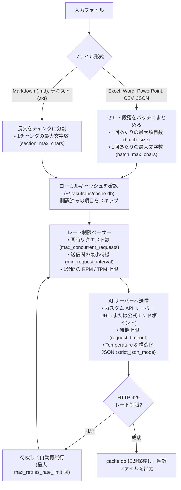
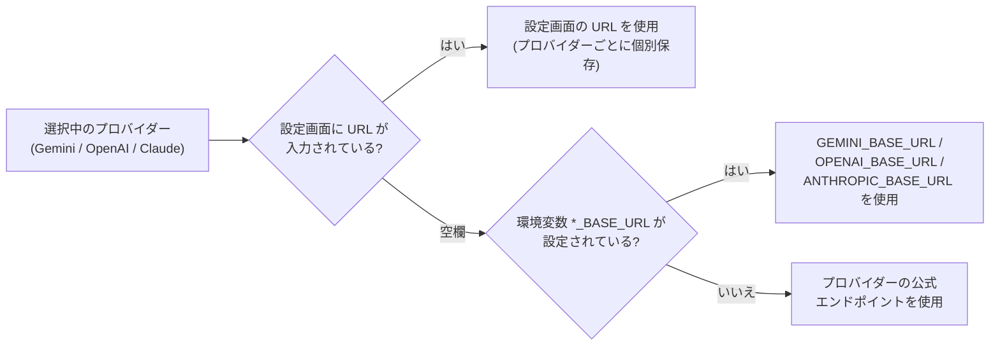

# 速度・詳細設定ガイド

[English](ADVANCED_SETTINGS.md) | [日本語](ADVANCED_SETTINGS.ja.md) | [Tiếng Việt](ADVANCED_SETTINGS.vi.md)

**設定 → 速度・詳細設定** の各項目がどのように動作するかを図解と設定例付きで説明します。

> **ポイント:** 通常利用では **変更不要** です。既定の **バランス** モードのまま最適に動作します。

---

## 1. 翻訳処理の全体フロー

---

## 2. プリセット一覧

プリセットを選ぶと下の 8 項目が一括設定されます。数値を手動で変更すると自動で **カスタム** に切り替わります。

| 項目 | 安全・低速 (`safe_free`) | バランス (`balanced` / 既定) | 高速 (`fast_paid`) |
| :--- | :---: | :---: | :---: |
| **推奨用途** | 無料 API キー、大容量ファイル | 日常の標準利用 | 有料・高上限プラン |
| **同時リクエスト数** | `1` | `2` | `4` |
| **最小待機時間 (秒)** | `4.0` | `0.5` | `0.2` |
| **RPM 上限 (回/分)** | `12` | `45` | `0` (無制限) |
| **TPM 上限 (トークン/分)** | `100,000` | `0` (無制限) | `0` (無制限) |
| **最大項目数 / 回** | `100` | `100` | `100` |
| **最大文字数 / 回 (Office等)** | `12,000` | `12,000` | `12,000` |
| **最大文字数 / チャンク (MD/TXT)** | `12,000` | `12,000` | `12,000` |
| **429 再試行上限** | `8` | `5` | `5` |

---

## 3. カスタム API サーバー URL の仕組み

**カスタム API サーバー URL** (`base_url`) を入力すると、モデル一覧取得・接続テスト・翻訳リクエストのすべてが公式サーバーではなく指定した URL へ送信されます。

### よくある利用例

1. **ローカル LLM (Ollama / LM Studio / vLLM)**:
   - **OpenAI** タブを選択します。
   - **Ollama**: `http://localhost:11434/v1`（API キーは `ollama` 等任意の文字列）。
   - **LM Studio**: `http://localhost:1234/v1`。
2. **OpenAI 互換 API**（OpenRouter、Groq、DeepSeek など）:
   - **OpenAI** タブを選び、該当サービスの Base URL（例: `https://openrouter.ai/api/v1`）を入力します。
3. **社内プロキシ / ゲートウェイ経由**:
   - 利用するプロバイダーのタブでゲートウェイ URL を入力します。

---

## 4. 各項目の詳細リファレンス

### AI 接続・出力設定

- **カスタム API サーバー URL (`base_url`)**: 公式サーバーを使う場合は空欄のままにします。
- **翻訳の柔軟性 / Temperature (`0.0 – 2.0`)**:
  - `0.0 – 0.3`: 原文に忠実で用語が安定（仕様書・表・契約書向け）。
  - `0.7 – 1.0`: より自然な意訳寄り。
  - **空欄**: モデル既定値を使用（推奨）。
- **リクエスト待機上限 (`request_timeout`、既定 `120` 秒、範囲 `5 – 600`)**: 1 回の API 応答を待つ最大秒数。推論に時間がかかるモデルやローカル LLM では `240 – 300` 秒へ延ばすと安定します。
- **構造化 JSON 出力を強制する (`strict_json_mode`、既定オン)**: セルや段落の対応ずれを防ぎます。独自プロキシや一部モデルで `response_format` エラーが出る場合のみオフにしてください。

### テキストの分割・まとめ送信

- **1回あたりの最大項目数 (`batch_size`、`1 – 500`)**: Excel / Word / PowerPoint / CSV / JSON で 1 バッチにまとめる最大セル・段落数。
- **1回あたりの最大文字数 (`batch_max_chars`、`200 – 100,000`)**: Excel / Word / PowerPoint / CSV / JSON の 1 バッチあたり文字数上限（件数または文字数のどちらか先に達した時点で分割）。
- **1チャンクの最大文字数 (`section_max_chars`、`200 – 100,000`)**: Markdown (`.md`) やテキスト (`.txt`) を分割する際の文字数上限。

### 並列実行・レート制限対策

- **同時リクエスト数 (`max_concurrent_requests`、`1 – 20`)**: 同時に実行する通信数。無料キーは `1`、有料キーは `2 – 4` が目安です。
- **送信間の最小待機時間 (`min_request_interval`、`0 – 60` 秒)**: 連続送信の開始間隔を空ける秒数。
- **制限エラー (HTTP 429) 時の自動再試行回数 (`max_retries_rate_limit`、`1 – 15`)**: 429 エラー時に待機してリトライする最大回数。
- **RPM 上限 (`rpm_limit`、`0 = 無制限`)**: 1 分間のリクエスト上限。
- **TPM 上限 (`tpm_limit`、`0 = 無制限`)**: 1 分間の推定トークン上限（1 トークン ≈ 英数字 3〜4 文字）。

---

## 5. トラブルシューティング早見表

- **HTTP 429 エラーが出る**: **安全・低速** に切り替えて「再試行」してください。完了分は `~/.rakutrans/cache.db` に保存済みのため続きから再開されます。
- **`response_format` エラーが出る**: **構造化 JSON 出力を強制する** のチェックを外してください。
- **ローカル LLM でタイムアウトする**: **同時リクエスト数** を `1`、**リクエスト待機上限** を `300` 秒に設定してください。
