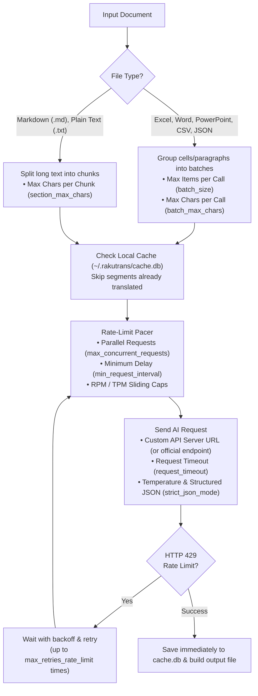
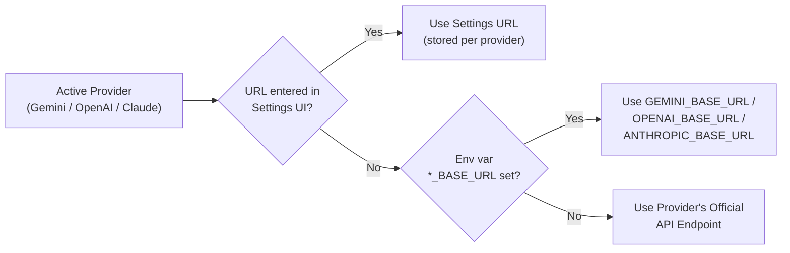

# Speed & Advanced Settings Guide

[English](ADVANCED_SETTINGS.md) | [日本語](ADVANCED_SETTINGS.ja.md) | [Tiếng Việt](ADVANCED_SETTINGS.vi.md)

This guide explains every option under **Settings → Speed & Advanced Settings**, with workflow diagrams and ready-to-use setups.

> **Quick tip:** Most users **never need to change these settings**. The default **Balanced** mode works well out of the box.

---

## 1. How a Document Translation Job Flows

---

## 2. Built-In Speed & Limit Presets

Selecting a preset updates all 8 rate-limit and batching parameters below. Editing any individual number automatically switches the dropdown to **Custom**.

| Setting | Slow & Safe (`safe_free`) | Balanced (`balanced`, default) | Fast (`fast_paid`) |
| :--- | :---: | :---: | :---: |
| **Best for** | Free API keys, very large files | Everyday translation | Paid / high-tier API keys |
| **Parallel Requests** | `1` | `2` | `4` |
| **Minimum Delay (s)** | `4.0` | `0.5` | `0.2` |
| **RPM Limit** | `12` | `45` | `0` (unlimited) |
| **TPM Limit** | `100,000` | `0` (unlimited) | `0` (unlimited) |
| **Max Items per Call** | `100` | `100` | `100` |
| **Max Chars / Call (Office/Table)** | `12,000` | `12,000` | `12,000` |
| **Max Chars / Chunk (MD/TXT)** | `12,000` | `12,000` | `12,000` |
| **429 Auto-Retries** | `8` | `5` | `5` |

---

## 3. How Custom API Server URL Works

**Custom API Server URL** (`base_url`) redirects model fetching, connection testing, and translation calls to an alternative endpoint instead of the provider's official server.

### Common Use Cases

1. **Local / Offline AI (Ollama, LM Studio, vLLM)**:
   - Select the **OpenAI** provider tab.
   - **Ollama**: enter `http://localhost:11434/v1` (any non-empty API key such as `ollama`).
   - **LM Studio**: enter `http://localhost:1234/v1`.
2. **OpenAI-Compatible Third-Party APIs** (OpenRouter, Groq, DeepSeek):
   - Select **OpenAI** and enter the provider's Base URL (e.g. `https://openrouter.ai/api/v1`).
3. **Corporate Proxy / Relay Gateway**:
   - Select the matching provider (`Gemini`, `OpenAI`, or `Claude`) and paste your gateway URL.

---

## 4. Parameter Reference

### AI Connection & Output

- **Custom API Server URL (`base_url`)**: Leave blank for the official endpoint. Saved independently per provider.
- **Creativity / Temperature (`0.0 – 2.0`)**:
  - `0.0 – 0.3`: Literal, consistent terminology (best for technical docs, tables, contracts).
  - `0.7 – 1.0`: More natural/expressive phrasing.
  - **Blank**: Uses the model's default temperature (recommended).
- **Request Timeout (`request_timeout`, default `120`s, range `5 – 600`)**: Max wait time per AI call. Increase to `240 – 300`s for slow reasoning models or CPU-bound local LLMs.
- **Require structured JSON output (`strict_json_mode`, default `True`)**: Keeps cell and paragraph alignment exact. Uncheck only if a custom proxy or model rejects `response_format`.

### How Documents Are Split

- **Max Items per Call (`batch_size`, `1 – 500`)**: Max cells or paragraphs bundled into one AI call for Excel, Word, PowerPoint, CSV, and JSON.
- **Max Chars per Call (`batch_max_chars`, `200 – 100,000`)**: Character budget per batch for Excel, Word, PowerPoint, CSV, and JSON. A batch closes when either `batch_size` or `batch_max_chars` is reached.
- **Max Chars per Chunk (`section_max_chars`, `200 – 100,000`)**: Chunk size when splitting Markdown (`.md`) or plain text (`.txt`) files.

### Speed & Rate-Limit Protection

- **Parallel Requests (`max_concurrent_requests`, `1 – 20`)**: Number of simultaneous in-flight AI calls. Use `1` for free keys; `2 – 4` for paid plans.
- **Minimum Delay (`min_request_interval`, `0 – 60`s)**: Minimum wait enforced between starting consecutive requests.
- **Auto-Retries on Rate Limit (`max_retries_rate_limit`, `1 – 15`)**: Maximum retry attempts with backoff on HTTP 429 responses.
- **RPM Limit (`rpm_limit`, `0 = off`)**: Sliding-window cap on requests per minute.
- **TPM Limit (`tpm_limit`, `0 = off`)**: Sliding-window cap on estimated tokens per minute (1 token ≈ 3–4 English characters).

---

## 5. Quick Troubleshooting Recipes

- **Frequent HTTP 429 errors**: Switch to **Slow & Safe** and click **Retry**. Completed batches are already cached in `~/.rakutrans/cache.db`.
- **`response_format` unsupported error on custom server**: Uncheck **Require structured JSON output**.
- **Timeouts on local LLM**: Set **Parallel Requests** to `1` and raise **Request Timeout** to `300`s.
