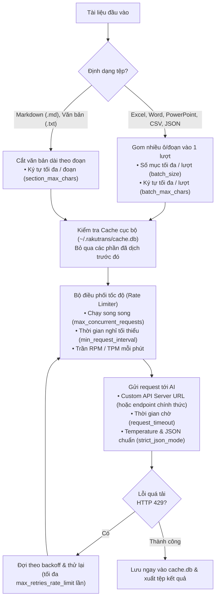
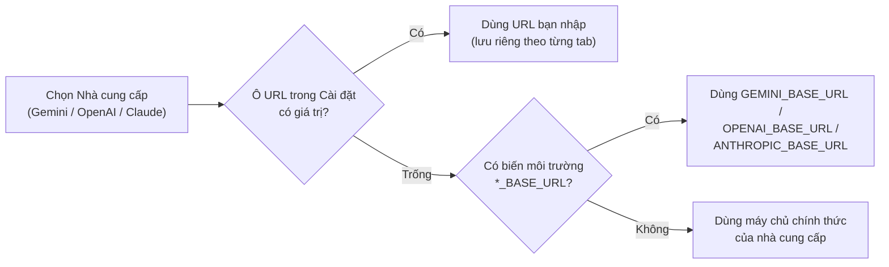

# Hướng dẫn Cài đặt Nâng cao & Tốc độ (Advanced & Performance)

[English](ADVANCED_SETTINGS.md) | [日本語](ADVANCED_SETTINGS.ja.md) | [Tiếng Việt](ADVANCED_SETTINGS.vi.md)

Tài liệu này giải thích trực quan toàn bộ các tùy chọn trong **Cài đặt → Tốc độ & Cài đặt nâng cao**, kèm sơ đồ luồng xử lý và các cấu hình mẫu thực tế.

> **Mẹo nhanh:** Bạn **không cần đụng vào mục này** nếu đang dùng bình thường. Bộ giá trị mặc định (**Cân bằng**) đã chạy ổn định cho đa số tài liệu.

---

## 1. Sơ đồ tổng quan: Một tài liệu được dịch như thế nào?

---

## 2. Chế độ tốc độ & chống lỗi giới hạn (Presets)

Chọn 1 trong 3 chế độ có sẵn sẽ tự động điền toàn bộ 8 thông số bên dưới. Nếu bạn tự sửa bất kỳ con số nào, mục này sẽ tự chuyển thành **Tùy chỉnh (`custom`)**.

| Thông số | Chậm & An toàn (`safe_free`) | Cân bằng (`balanced`, mặc định) | Tốc độ cao (`fast_paid`) |
| :--- | :---: | :---: | :---: |
| **Khi nào nên chọn?** | API key miễn phí (hay bị lỗi 429), file lớn | Sử dụng hàng ngày | API trả phí gói cao |
| **Số lượt chạy song song** | `1` | `2` | `4` |
| **Nghỉ tối thiểu giữa 2 lượt** | `4.0` giây | `0.5` giây | `0.2` giây |
| **Giới hạn RPM (lượt/phút)** | `12` | `45` | `0` (không giới hạn) |
| **Giới hạn TPM (token/phút)** | `100,000` | `0` (không giới hạn) | `0` (không giới hạn) |
| **Số mục tối đa / 1 lượt** | `100` | `100` | `100` |
| **Ký tự tối đa / 1 lượt (Office)** | `12,000` | `12,000` | `12,000` |
| **Ký tự tối đa / 1 đoạn (MD/TXT)** | `12,000` | `12,000` | `12,000` |
| **Số lần thử lại lỗi 429** | `8` | `5` | `5` |

---

## 3. Custom API Server URL hoạt động như thế nào?

Ô **Địa chỉ máy chủ API riêng** (`base_url`) cho phép chuyển hướng toàn bộ request (lấy danh sách model, kiểm tra kết nối và dịch tài liệu) sang một máy chủ khác thay vì máy chủ mặc định của Google/OpenAI/Anthropic.

### Các tình huống dùng Custom API Server URL phổ biến

1. **Chạy AI nội bộ trên máy cá nhân (Local LLM)** — không cần internet, không tốn phí API:
   - Chọn tab **OpenAI** (vì hầu hết tool local dùng chuẩn API của OpenAI).
   - **Ollama**: nhập `http://localhost:11434/v1` (API Key nhập chuỗi bất kỳ, VD: `ollama`).
   - **LM Studio**: nhập `http://localhost:1234/v1`.
2. **Dùng nhà cung cấp tương thích OpenAI** (OpenRouter, Groq, DeepSeek, vLLM…):
   - Chọn tab **OpenAI** và dán Base URL của nhà cung cấp đó (VD: `https://openrouter.ai/api/v1`).
3. **Đi qua Proxy / Gateway của công ty**:
   - Chọn đúng tab nhà cung cấp (`Gemini`, `OpenAI` hoặc `Claude`) và dán URL cổng trung gian nội bộ.

---

## 4. Giải thích từng thông số chi tiết

### Nhóm 1: Kết nối AI & Kiểu trả lời

- **Địa chỉ máy chủ API riêng (`base_url`)**: Xem mục 3 ở trên. Để trống nếu dùng API chính thức.
- **Độ sáng tạo câu chữ / Temperature (`0.0 – 2.0`)**:
  - `0.0 – 0.3`: Dịch sát nghĩa, nhất quán thuật ngữ (phù hợp tài liệu kỹ thuật, hợp đồng, bảng biểu).
  - `0.7 – 1.0`: Câu chữ tự nhiên, linh hoạt hơn (phù hợp bài viết, marketing).
  - **Để trống**: Dùng giá trị mặc định của model đang chọn (khuyên dùng).
- **Thời gian chờ tối đa (`request_timeout`, mặc định `120` giây, phạm vi `5 – 600`)**: Thời gian tối đa đợi AI phản hồi xong 1 lượt. Nếu bạn dùng model suy luận chậm hoặc chạy local trên CPU/GPU yếu, hãy tăng lên `240` hoặc `300`.
- **Ép AI trả kết quả đúng định dạng JSON chuẩn (`strict_json_mode`, mặc định bật)**:
  - Giúp AI trả về mảng JSON khớp chính xác từng ô Excel hoặc từng đoạn Word.
  - **Chỉ tắt** khi bạn dùng proxy hoặc model tự host bị lỗi có chữ `response_format`.

### Nhóm 2: Cách chia nhỏ tài liệu để gửi AI

- **Số mục tối đa mỗi lần gửi (`batch_size`, phạm vi `1 – 500`)**: Áp dụng cho Excel, Word, PowerPoint, CSV, JSON. Quy định tối đa bao nhiêu ô/đoạn được gom chung 1 request.
- **Số ký tự tối đa / 1 lượt (`batch_max_chars`, phạm vi `200 – 100,000`)**: Giới hạn tổng số ký tự của các ô/đoạn trong 1 batch (áp dụng cho Excel, Word, PowerPoint, CSV, JSON). Một batch kết thúc khi chạm `batch_size` **hoặc** `batch_max_chars` (tùy điều kiện nào tới trước).
- **Số ký tự tối đa / 1 đoạn (`section_max_chars`, phạm vi `200 – 100,000`)**: Chỉ áp dụng cho Markdown (`.md`) và văn bản thuần (`.txt`) để cắt tài liệu dài thành các phần vừa phải.

### Nhóm 3: Tốc độ gửi & Chống quá tải API

- **Số lượt dịch chạy song song (`max_concurrent_requests`, phạm vi `1 – 20`)**: Số request gửi đồng thời. Đặt `1` cho key miễn phí; tăng lên `3 – 4` nếu dùng gói trả phí để dịch nhanh hơn.
- **Thời gian nghỉ giữa các lượt gửi (`min_request_interval`, phạm vi `0 – 60` giây)**: Khoảng trễ tối thiểu giữa 2 lần bắt đầu request liên tiếp.
- **Số lần tự thử lại khi bị quá tải (`max_retries_rate_limit`, phạm vi `1 – 15`)**: Khi nhận mã HTTP 429 (quá giới hạn), app tự tạm nghỉ rồi thử lại tối đa số lần này.
- **Giới hạn RPM (`rpm_limit`, `0 = tắt`)**: Số request tối đa mỗi phút (VD: `12` cho Gemini Free Tier).
- **Giới hạn TPM (`tpm_limit`, `0 = tắt`)**: Số token ước lượng tối đa mỗi phút (1 token ≈ 3–4 ký tự tiếng Anh).

---

## 5. Gợi ý xử lý nhanh khi gặp sự cố

- **Gặp lỗi 429 (Rate Limit / Quota Exceeded)**: Chọn chế độ **Chậm & An toàn** rồi bấm **Thử lại**. Các phần đã dịch xong trước đó đã được lưu trong `~/.rakutrans/cache.db` nên sẽ không bị dịch lại.
- **Server tự host báo lỗi `response_format` / `json_object`**: Bỏ tích **Ép AI trả kết quả đúng định dạng JSON chuẩn**.
- **Model local trả lời chậm hay bị timeout**: Tăng **Thời gian chờ tối đa** lên `300` giây và giảm **Số lượt chạy song song** xuống `1`.
